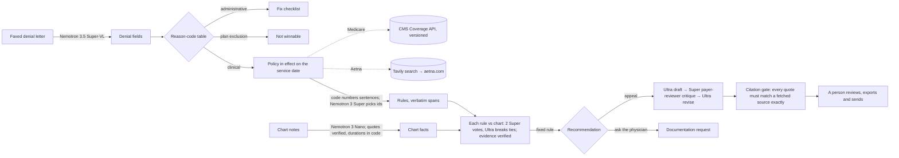

# Denial Auditor

> Payers check your MRI order criterion by criterion. Denial Auditor lets a three-doctor practice do the same.

Denial Auditor helps billing staff at small medical practices work health-insurance denials for outpatient **lumbar MRI**. It:

- **triages** each denial by whether it can be won (administrative fix, plan exclusion, or clinical);
- fetches the payer's **coverage policy in effect on the date of service** (CMS keeps every version; Aetna's bulletin is located at runtime with Tavily);
- splits the policy into rules cut **word for word from the source**, and checks each rule against the chart with **verified quotes**;
- decides with a **fixed rule, not a model**: appeal, ask the physician, don't appeal yet, fix and resubmit, or not winnable;
- drafts an appeal that **can't be exported** unless every quoted line matches the fetched policy or chart exactly.

**Before you submit** runs the same checks on a prior-auth request, and when a waiting period is the only problem it works out, in code, the earliest date the chart can meet it. A **policy watch** re-checks every open case's policy nightly and names the rules whose wording changed.

Built for the [Nebius x NVIDIA Global AI Hackathon](https://nebiusglobalaihackathon.devpost.com/), **Best Apps & Agents** track, by team **Road House**: Aman Bihari and Bhawna.

**Live demo:** https://denial-auditor-898760356208.us-central1.run.app (sign in with the one-click demo account; the eight showcase cases are free to browse; live runs need the passcode in the Devpost testing instructions). The first visit after a quiet spell can take a few seconds while the server wakes.

## Architecture



Models only ever return text; code checks it. Policy rules are sentence ranges cut from the fetched text, every chart quote is located in its note, durations are computed from dates, deadlines come from a table checked against eCFR, and the recommendation is a fixed rule over the rule statuses.

| Step | Model / service |
|---|---|
| Read the scanned denial letter | Nemotron 3.5 Super-VL (Token Factory) |
| Split the policy into rules (pick sentence ids) | Nemotron 3 Super |
| Extract chart facts with quotes | Nemotron 3 Nano |
| Check each rule against the chart | Nemotron 3 Super ×2; Nemotron 3 Ultra when the votes split |
| Draft, critique, revise the appeal | Nemotron 3 Ultra / Super / Ultra |
| Locate the Aetna bulletin at runtime | Tavily search |
| Versioned Medicare coverage policies (LCD L34220) | CMS Coverage API |
| Policy watch | Nightly Cloud Run job; no model ($0 cap) |

## Evaluation

30 synthetic cases in 7 groups (`cases/`, ground truth in each `scenario.json`; gold policy anchors in `eval/gold/`). Every letter is read from the scanned image.

| | Super ×2 + Ultra referee | Nano, one vote |
|---|---|---|
| Triage route | 30/30 | 29/29 ¹ |
| Recommendation | 30/30 | 16/29 (55%) |
| Gold rule statuses | 138/138 | 119/131 (91%) |
| Mean cost per case | $0.048 | $0.010 |
| Mean time per case | 72 s | 90 s |

¹ One Nano run produced malformed output (a runaway answer cut off mid-JSON) and isn't scored. Nano's misses are mostly the red-flag route marked as blocking when the patient simply has no red flags (8 of 18), and four weeks of documented care marked as undocumented (3 of 18). Two Super votes with an Ultra referee cost about 5× more and get every recommendation right on this set.

Reports: `eval/results/final_super_scan.md`, `eval/results/final_nano_scan.md`. The cases are synthetic and the ground truth is ours, so these numbers show the pipeline is consistent on the situations we designed, not how it does on real charts.

```bash
./.venv/bin/python eval/run_eval.py --matcher super --votes 2 --tag NAME   # ~$1.50 for 30 cases
./.venv/bin/python eval/run_eval.py --rescore NAME                          # re-score a saved run, $0
```

## Setup

Needs Python 3.12 and Node 20+.

```bash
python3 -m venv .venv
./.venv/bin/pip install -e '.[app,dev]'
cp .env.example .env      # add TAVILY_API_KEY and NEBIUS_TOKEN_FACTORY_KEY (DEMO_PASSCODE enables live runs)
./.venv/bin/pytest        # offline tests; any network call fails a test

cd ui && npm ci && npm run build && cd ..                # the web app (React + shadcn) -> ui/dist
./.venv/bin/uvicorn nebius_nvidia.api:app --port 8600   # open http://127.0.0.1:8600
```

The server serves `ui/dist` at `/` (and the earlier plain-HTML version at `/classic/`). For frontend work, run `cd ui && npx vite --port 5173` alongside the server; it proxies `/api` to port 8600.

- One case end to end on the command line: `./.venv/bin/python -m nebius_nvidia.pipeline cases/case_001` (a few cents).
- A prior-auth check: `./.venv/bin/python -m nebius_nvidia.prevention cases/case_009`.
- The policy watch: `./.venv/bin/python -m nebius_nvidia.drift` ($0).
- Container: `docker build -t denial-auditor .` builds the web app and the API into one image (port 8501).
- Deploy (Google Cloud Run, scale to zero): `gcloud run deploy denial-auditor --source . --region us-central1` with the keys as Secret Manager secrets and a Cloud Storage bucket mounted at `/state` for the spend ledger and the policy-watch report. The nightly policy watch runs as a Cloud Run job on a Cloud Scheduler trigger.

Spending is hard-capped in code (`src/nebius_nvidia/budget.py`): every Token Factory request and Tavily call is checked against its cap before it is sent. Override the caps with `TOKEN_FACTORY_BUDGET_USD` and `TAVILY_CREDIT_CAP`.

## Important notices

- **Synthetic data only.** No real patient information is used anywhere in this repository, the demo or the video.
- **Decision support, not advice.** Denial Auditor helps billing staff prepare appeals. It is not legal or medical advice, and a human always reviews and sends the appeal. The tool never submits anything.
- **CPT®** codes are shown as bare codes only. CPT is a registered trademark of the American Medical Association; CPT descriptors are © American Medical Association, all rights reserved. Retrieving full LCD text through the CMS Coverage API requires accepting the AMA CPT license for personal, non-commercial use.
- Payer policies are fetched live from their public sources and quoted briefly with attribution, a link and the effective date. They are not redistributed. eviCore, Carelon and ACR Appropriateness Criteria content is linked by name only, because their terms prohibit reuse.

## License

[Apache-2.0](LICENSE)
